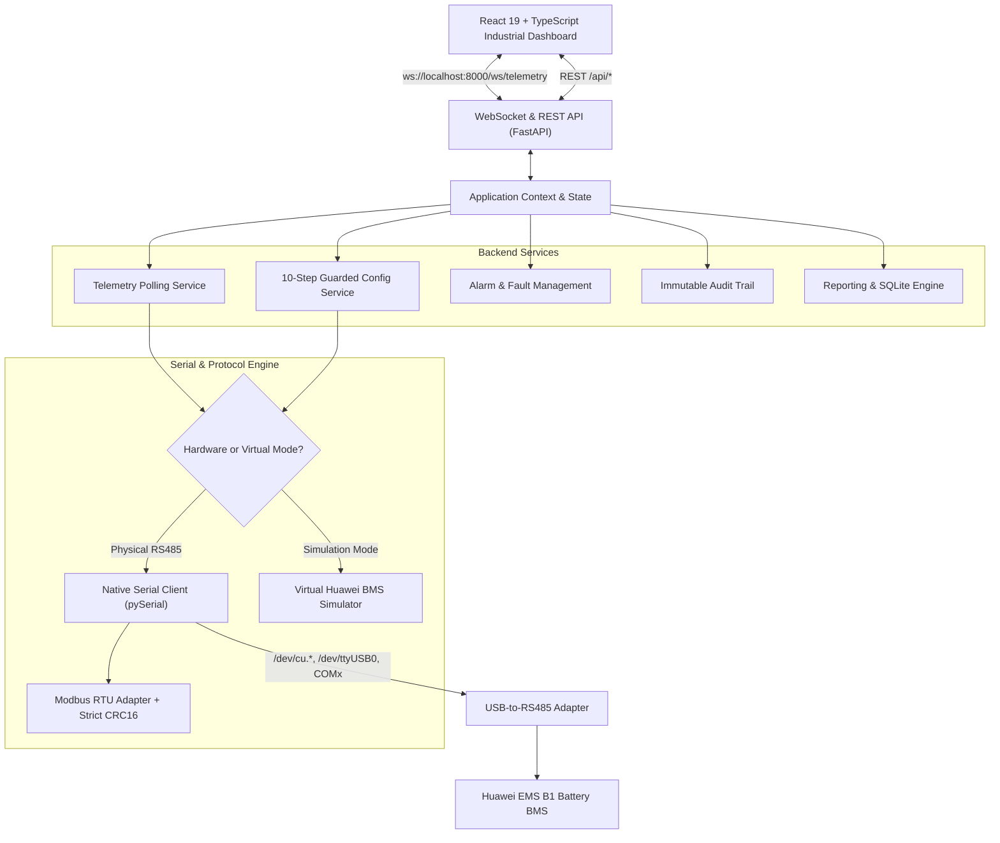

# Huawei EMS B1 Battery Manager

A production-quality desktop and serial hardware integration application designed to monitor, manage, and diagnose the **Huawei EMS B1 Battery Management System (BMS)** directly through a **USB-to-RS485 serial adapter**.

Built with a modular architecture separating native serial communications, Modbus RTU protocol framing, SQLite persistent telemetry storage, and a responsive industrial React user interface.

---

## 1. System Architecture



---

## 2. Multi-Platform Standalone Installers

Standalone desktop application packages are available for **macOS**, **Windows**, and **Linux**. These installers bundle Python 3, PySerial, all register maps, and the compiled React user interface into a self-contained desktop application. **No developer tools (Python, Node.js, npm) are required by end users.**

| Platform | Package Format | Installation Method |
| :--- | :--- | :--- |
| **macOS** | `.dmg` Disk Image (Apple Silicon & Intel) | Open `.dmg` and drag `Huawei EMS B1 Battery Manager.app` to `/Applications`. |
| **Windows** | `.exe` Setup Wizard & Portable `.zip` | Run `Huawei-EMS-B1-Manager-Windows-x64-Setup.exe` (creates desktop & start menu shortcuts). |
| **Linux** | `.tar.gz` + Automated System Installer | Extract archive and execute `sudo ./install.sh` (installs to `/opt` & sets up dialout permissions). |

*Full documentation: [docs/STANDALONE_INSTALLERS.md](docs/STANDALONE_INSTALLERS.md)*

### Building Installers from Source:
```bash
# Universal cross-platform build (auto-detects OS):
python3 scripts/build_installer.py

# Or via npm shortcut:
npm run build:installer
```

---

## 3. Key Capabilities & Safety Protections

### A. Real Hardware Integration
- **Direct Serial Access:** Communicates directly with USB-to-RS485 adapters (FTDI, Silicon Labs CP210x, WCH CH340, Prolific).
- **Auto-Discovery:** Automatically scans and enumerates operating system serial ports (`/dev/cu.*` on macOS, `/dev/ttyUSB*` on Linux, `COMx` on Windows) with vendor ID, product ID, and hardware descriptions.
- **Half-Duplex Direction Control:** Supports configurable inter-frame delays ($3.5\text{ char times}$) and optional RTS pin hardware toggling.

### B. Protocol Rigor & Zero Fabrication Policy
- **Strict CRC-16 Verification:** Every incoming and outgoing Modbus RTU frame is validated against standard Modbus polynomial `0xA001`.
- **Exception Distinctions:** Distinguishes between unsupported register addresses (`0x02 Illegal Data Address`), busy states (`0x06`), and physical communication dropouts.
- **Unavailable Sentinel Handling:** Decodes Huawei sentinels (`0xFFFF`, `0x7FFF`, `0xFFFFFFFF`) as `N/A` rather than presenting fake zero readings.

### C. The Mandatory 10-Step Guarded Write Workflow
To protect battery electrochemistry and prevent unauthorized parameter tampering:
1. **Default Read-Only:** System starts strictly locked in Read-Only Mode.
2. **Administrator Authentication:** Requires Administrator role to unlock write capability.
3. **Allowlist Enforcement:** Writes are restricted to verified allowlisted registers (`47081`, `47083`, `47085`, `47086`). Undocumented registers cannot be written.
4. **Range Bounds Check:** Validates engineering units against manufacturer min/max bounds.
5. **Before-and-After Diff:** Displays live vs target value side-by-side.
6. **Operator Confirmation:** Requires explicit confirmation of operational impact.
7. **Read-Back Verification:** Immediately reads holding registers back from the device after transmission to confirm the battery accepted the change.
8. **Permanent Audit Log:** Records every write attempt into SQLite `audit_log`.

### D. Full Virtual BMS Simulator
- Provides a high-fidelity virtual battery electrochemistry simulator with realistic SOC drift, voltage curve, 16 series cell voltages, passive balancing, and fault injection.
- Prominently marked with **SIMULATED BMS (VIRTUAL)** so it can never be mistaken for physical hardware.

---

## 3. The 13 Industrial Application Pages

| # | Page Name | Primary Features |
| :---: | :--- | :--- |
| **1** | **Dashboard** | Battery SOC %, SOH %, Voltage (V), Current (A), Power (kW), Temperature (°C), Operating State (Charging, Discharging, Idle, Fault), 16-cell mini visualizer. |
| **2** | **Connect Device** | Serial port auto-discovery, COM port selection, baud rate (9600–115200), parity, stop bits, slave ID, timeout tuning, preset selector, and simulator switch. |
| **3** | **Electrical Monitoring** | DC bus voltage, contactor switchgear status, precharge state, insulation resistance ($k\Omega$), cumulative energy counters (kWh), power envelope limits, real-time trend charts. |
| **4** | **Cell & Module View** | 16 individual cell voltages, $\Delta V$ spread (mV), outlier cell highlighting with configurable threshold, passive balancing indicators, 8 temperature sensors. |
| **5** | **Alarms & Faults** | Active hardware alarms, manufacturer-documented corrective actions, severity filters, historical alarm event log, and test fault injectors. |
| **6** | **Configuration** | Read all documented holding parameters, display raw and decoded values, admin unlock, and trigger the 10-step guarded write workflow. |
| **7** | **Config Snapshots** | Save point-in-time configuration snapshots, compare snapshots against live device parameters in a side-by-side diff table, and rollback parameters. |
| **8** | **Historical Trends** | Interactive time-series charts (1h, 6h, 24h, 3 days) for SOC, Voltage, Current, Power, Temperature, and Cell Spread with exact hover timestamps. |
| **9** | **Reports & Export** | High-level operational summary reports, energy throughput efficiency %, CSV telemetry export, CSV audit trail export, and SQLite online backup. |
| **10** | **Diagnostics & Trace** | Serial bus statistics (requests, responses, latency ms, timeouts, CRC errors, retries), live Modbus RTU byte stream inspector, and gated raw-frame transmitter. |
| **11** | **Register Database** | Browse registered Modbus definitions, scale factors, data types, and documentation citations. Import/export register maps in CSV and JSON. |
| **12** | **App Settings** | Operator notification thresholds for low SOC, high temperature, cell spread $\Delta V$, persistence hysteresis timers, and storage retention limits. |
| **13** | **Audit Log** | Immutable security audit trail of all administrative parameter write attempts, validation outcomes, and read-back verification results. |

---

## 4. Quickstart Guide

### One-Command Start (Both Servers)
```bash
./scripts/start.sh
```
- Frontend UI: `http://localhost:5173`
- Backend API Docs: `http://127.0.0.1:8000/docs`

### Running the Test Suite
```bash
./scripts/run_tests.sh
```
Runs the full backend pytest suite (14 tests covering CRC-16, Modbus RTU framing, register encoding/decoding, safety bounds, allowlists, and simulator) and verifies the TypeScript production bundle.

---

## 5. Hardware Setup & Documentation Guides

- [RS485 Wiring & Polarity Guide](docs/RS485_WIRING_GUIDE.md) - Pinouts, termination resistors, and A/B inversion troubleshooting.
- [Windows Installation Guide](docs/INSTALLATION_WINDOWS.md) - COM port driver setup and execution.
- [Linux Installation Guide](docs/INSTALLATION_LINUX.md) - Dialout permissions, `/dev/ttyUSB0`, and ModemManager contention.
- [macOS Installation Guide](docs/INSTALLATION_MACOS.md) - `/dev/cu.*` port selection and driver notes.
- [Register Map Reference](docs/REGISTER_MAP_REFERENCE.md) - Official Huawei Solar/ESS Modbus definitions and conventions.
- [Security & Audit Policy](docs/SECURITY_AND_AUDIT.md) - Guarded write steps, RBAC, and safety invariants.
